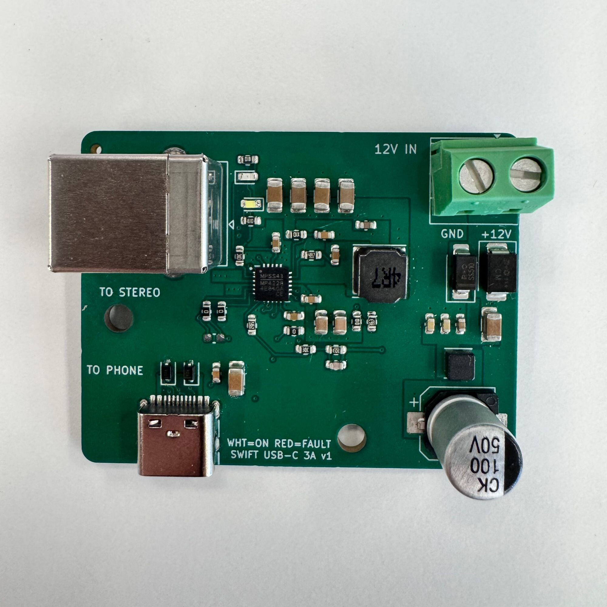
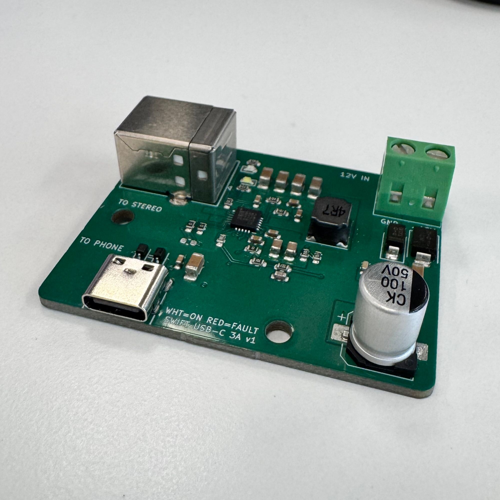

# 12 V to USB-C data splitter

A car board that turns 12 V into 5 V at 3 A (15 W) on a USB-C socket for the phone, and passes the factory stereo's USB
data through to the same phone. I made it for a car stereo that talks to the phone over the old iPod USB protocol, and
an iPhone 15 Pro. The board does not use USB PD, so the iPhone keeps its USB data link to the stereo while it charges.

v1 is built, and it works great.

  
  

## Board

- Converter and USB switch: MPS MPQ4228-C (AEC-Q100), 420 kHz, line-drop compensation, BC1.2 CDP and Type-C Rp.
- Input: 2-pin 5.08 mm screw terminal, SMBJ33CA TVS, SS510 (100 V) reverse diode, LC filter.
- Stereo side: USB-B socket (J2). Phone side: USB-C socket (J3), to a panel-mount extension in the dash.
- LEDs: white is 5 V on, red is fault.
- 4 layers, 52 × 40 mm, 1.6 mm thick, two M3 holes.

## Files

- `fab/`: the Gerber zip to upload, the same files unzipped in `fab/gerber/`, JLCPCB BOM and CPL files in
  `fab/assembly/`, and schematic, assembly and layer PDFs in `fab/docs/`.
- `docs/`: 3D renders, an A5 schematic PDF and the photos above.
- The KiCad 10 project in the repo root, with the custom MPQ4228 symbol and footprint in `lib/`.
- `scripts/`: the KiCad Python scripts that built the schematic fields, the routing and the fab pack.
- `sim/`: ngspice simulation of the input chain and hand calculations, with results.

## Order at JLCPCB

JLCPCB was the cheapest fab I found. Upload the Gerber zip from `fab/`.

- PCB: 4 layers, 1.6 mm, qty 5, green. Keep JLC's defaults, including **Min via hole size 0.3mm/(0.4/0.45mm)**
  (all vias are 0.3 mm drill). The 0.25 mm option adds about US$37 (via fee plus a forced 4-wire Kelvin test).
- Assembly: Economic PCBA, top side, assemble 2 of the 5 boards.
- BOM: `fab/assembly/*-bom-jlc.csv`. CPL: `fab/assembly/*-cpl-jlc.csv`. In the BOM step, tick the "L3,L4,R9" (0R)
  line: JLC leaves it unselected.
- Tick Confirm Parts Placement (US$0.45). JLC engineers then check the rotations of U1, D1–D6, C1 and J3. JLC's preview
  shows J3 offset towards the board edge.
- Product description (customs): "DIY Hobby Circuit Board – HS Code 902300".
- Shipping: Global Standard Direct Line (US$7.24 to NZ, 10–15 business days, orders up to US$150).

JLCPCB quote on 07/10/2026 for 5 boards with 2 assembled:

| Line | US$ |
|---|---|
| PCB | 8.00 (2.00 through the JLCONE desktop app) |
| Setup 8.24 + stencil 1.55 | 9.79 |
| Components, 30 lines | 14.27 |
| Extended components fee (U1, J3, C1, L1, L2, C2/C3, D3/D4) | 21.63 |
| SMT assembly, placement check, nitrogen reflow | 1.88 |
| Shipping, Global Standard Direct Line | 7.24 |
| Automatic cart coupon | −10.00 |
| **Total before GST** | **≈ 52.81 (≈ NZ$90)**; ≈ US$61 / NZ$103 with 15 % GST |

The GST line and new-user coupons only show at checkout, after you enter the shipping address.

J1 (screw terminal) and J2 (USB-B) are through-hole. If you do not want to solder anything, upload
`fab/assembly/*-with-tht-bom-jlc.csv` and `fab/assembly/*-with-tht-cpl-jlc.csv` instead. JLC then hand-solders both
parts in Economic PCBA for US$5.61 more (US$61.18 instead of US$55.57 on 07/10/2026; hand-soldered parts have no
extended fee). Otherwise buy C7509570 and C19944605 and solder the 10 joints yourself.

The CPL files shift J1, J2 and J3 so that JLC's (EasyEDA) footprint origins land on the KiCad footprints (`CPL_FIX` in
`scripts/jlc_files.py`). Without the shift, JLC's preview puts J3 1.42 mm towards the board edge.

On 07/10/2026 PCBWay, Seeed, ALLPCB, NextPCB and Elecrow were all more expensive for 2 assembled boards. NextPCB's
"Rev 0" free assembly offer could be cheaper, but it needs a live quote and its parts do not come from LCSC.

## Parts for the car

| Item | Source | NZ$ |
|---|---|---|
| Panel-mount USB-C male-to-female extension, USB 3.1 type (passes CC) | [AliExpress 1005010641105986](https://www.aliexpress.com/item/1005010641105986.html) | ≈ 6.30 |
| Short USB-A male to USB-B male cable | [AliExpress 32700175631](https://www.aliexpress.com/item/32700175631.html) or a spare printer cable | 0–5.60 |
| Micro2 add-a-circuit fuse tap and a 5 A Micro2 fuse | [AliExpress 1005006019784140](https://www.aliexpress.com/item/1005006019784140.html) or a car parts shop | ≈ 0.50–8 |
| 0.75–1 mm² wire, ring terminal for ground | on hand | |

Wiring: console USB-A socket → USB-A to USB-B cable → J2. J3 → panel-mount USB-C extension → phone. Fuse tap on an ACC
fuse → 5 A fuse → J1 "+12V". J1 "GND" → body ground near the stereo. The stereo's 5 V does not connect to anything on
the board.

## Bring-up

1. Before you apply power, measure J1 + to GND and J3 VBUS to GND. Neither may be a short.
2. Bench supply at 12 V with a 0.5 A limit, no phone. The white LED is on and the red LED is off. J3 VBUS reads about
   5.0 V only after a sink is attached (the phone, or a USB-C to USB-A adapter with a load). Idle input current is
   about 15–25 mA, because the chip switches all the time (forced CCM at 420 kHz) and the white LED is on.
3. Phone on the bench, 12 V with a 2 A limit: the iPhone shows that it is charging, and the input draws about 1.4 A at
   12 V for 15 W.
4. In the car, the stereo sees the iPod as before and the phone charges.
5. Before you fit the panel extension, measure its female A5 to B5 with a meter. It must be open (CC1 and CC2 not
   joined), and each pin must reach the plug. Joined CC lines look like a debug accessory, and U1 then keeps VBUS off.
6. At 12 V and a 3 A load, feel or measure D2 (SS510): it dissipates about 1 W. In the car (14 V) it is about 0.8 W.
7. Unplug the phone at full load and watch the red LED. A flash means that the USB_IN OVP (5.85 V min) tripped on the
   load release. If it does, lower the line-drop gain (R7 27k with R8 5.1k).

VBUS on J3 stays at 0 V until a sink attaches. That is correct: the white LED shows VOUT, not VBUS.

## Design notes

- Output set point is 0.792 V × (1 + 30k/5.6k) = 5.03 V. ADJ adds about 2 µA/A × 30 kΩ, so +0.18 V at 3 A to
  compensate for cable drop.
- L3/L4 (18 nH eye-diagram tuning in the MPS reference design) are fitted as 0 Ω, and C29 (3.3 pF) is not fitted, so
  that every passive is a JLC basic part. If USB data is unreliable, fit 18 nH (C6807995) and 3.3 pF.
- The MPQ4228 footprint in `lib/` is drawn from the datasheet land pattern. Compare it with the JLC footprint preview
  before you pay.
- The MPQ4228 is rated 40 V absolute maximum, and the SMBJ33CA starts to conduct at 36.7 V. The LC filter and C1 keep
  VIN1 at or below 34.4 V in every simulated ISO pulse (see Checks).
- The red FAULT LED loads VCC2 (the 3.45 V internal LDO) with about 1.5 mA, but only while FLT is low.
- The VOUT feed to U1 USB_IN runs on In2 (0.5 oz) and, in parallel, on a 1 oz B.Cu strip (x 116.6–118.4). The B.Cu
  path carries about two thirds of the 3 A. This avoids JLC's US$18 charge for 1 oz inner copper.

## Checks (07/10/2026)

MPS publishes no SPICE model for the MPQ4228 (SIMPLIS only), so the converter itself is not simulated.

- `sim/input_sim.py` (ngspice) models the input chain with the chip as a 17.7 W constant-power load, through ISO
  7637-2 and ISO 16750-2 pulses at both SMBJ33CA tolerance ends. Results are in `sim/results.md`. Everything passes
  except the unsuppressed 87 V load dump (about 230 J into the TVS), which no small TVS survives. The board relies on
  the car's alternator load-dump suppression, and a shorted TVS blows the 5 A fuse. Pulse 1 put 60.6 V across the
  first-choice SS56 (60 V), so D2 is now an SS510 (100 V, 75.9 V seen). The input filter is stable, with at least 9 dB
  margin at 6 V input.
- `sim/calcs.py`: output voltage 4.85–5.22 V at no load and at most 5.45 V at 3 A worst case; L1 peak at most 5.31 A
  (Isat 5.5 A); U1 Tj ≈ 100–122 °C and D2 Tj ≈ 118 °C at 60–70 °C ambient. Results are in `sim/calcs.md`.
- A separate AI design review found that the pin map, D+/D− routing, Type-C DFP and CDP set-up, footprint land pattern
  and passive values all match the datasheet. It added 10 GND vias (U1 heat path, C4 return, D3/D4 ESD return). An
  SMBJ24CA was rejected because it burns in a 35 V suppressed load dump in simulation. Open, low-risk items: FB/FREQ
  trace lengths, D3/D4 are polarised (the JLC placement check covers this), and there are no ESD diodes on the J2 side.
- Not covered: control-loop stability, load-step response and EMI.

## Scripts

Run the scripts with KiCad's Python (`/Applications/KiCad/KiCad.app/Contents/Frameworks/Python.framework/Versions/3.9/bin/python3`
on macOS). They assume KiCad 10 in `/Applications`.

- `scripts/make_lib.py` (symbol and footprint), then `add_fields.py` and `cost_parts.py` (JLC basic part swaps) on the
  schematic.
- `scripts/rename_nets.py`, then `sync_parity.py` (board from the schematic netlist).
- `scripts/copper.py <board> --routing`, then `route.py <board> <workdir>` (Freerouting, expected at
  `~/.kicad-mcp/freerouting.jar`), then `copper.py <board>`.
- `scripts/silk.py`, then `scripts/fab.sh` to write `fab/`.
- `uv run sim/input_sim.py` and `python3 sim/calcs.py` for the checks.

## Licence

CERN Open Hardware Licence Version 2, Strongly Reciprocal (CERN-OHL-S-2.0). See [LICENSE](LICENSE).
Source: https://github.com/Senyeah/12v-to-usb-c-data-splitter
